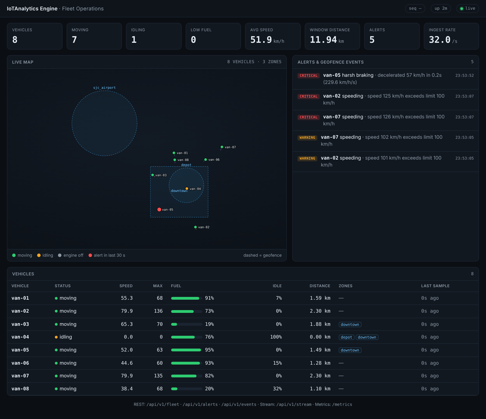

<div align="center">

# 🚚 IoTAnalytics-Engine

### Real-time IoT fleet analytics & field-operations engine

*Sliding-window telemetry · composable safety alerts · geofencing · durable event log · resumable SSE streaming · Prometheus/Grafana observability · TypeScript SDK*

<p>


</p>

<p>


</p>

</div>

---

A production-shaped analytics backend for connected vehicles and field assets.
Telemetry comes in over HTTP; the engine computes rolling per-vehicle metrics,
raises de-duplicated safety alerts, detects geofence crossings, persists every
operational event to a crash-safe append-only log, and pushes it all live to
dashboards and mobile clients over Server-Sent Events, with Prometheus metrics
and a provisioned Grafana board for operations.

**Zero third-party Go dependencies.** Everything from the HTTP router to the
Prometheus exporter is built on the standard library, so the whole system
builds in seconds, has no supply-chain surface, and is readable end to end.

## 60-second demo

```bash
go run ./cmd/server -simulate 8          # engine + 8 simulated vehicles
open http://localhost:8080               # live operations dashboard
```



Or the full observability stack:

```bash
docker compose up --build                # engine + Prometheus + Grafana
# http://localhost:8080  dashboard   http://localhost:3000  Grafana   http://localhost:9090  Prometheus
```

## What it does

| Capability | Where | How it works |
|---|---|---|
| **Sliding-window aggregation** | [`internal/aggregation`](internal/aggregation) | One concurrency-safe window per vehicle; late samples are inserted in order and aged-out readings evicted. A single pass yields avg/max speed, idle count & ratio, haversine distance travelled and fuel burn. `Fleet` rolls these up into KPIs. |
| **Composable alert engine** | [`internal/alerts`](internal/alerts) | A `Rule` interface with a generic `Threshold` builder plus escalating `Speeding`/`LowFuel` and *stateful* `HarshBraking` and `ExcessiveIdle`. The `Engine` de-duplicates with a per-vehicle cooldown (an escalation to a higher severity breaks through), orders by severity and keeps a bounded ring-buffer history. |
| **Geofencing** | [`internal/geofence`](internal/geofence) | `Circle` (great-circle radius) and `Polygon` (ray casting) zones behind one interface, loadable from JSON. The `Monitor` tracks per-vehicle membership and emits events only on *transitions*, with dwell time on exit and live occupancy per zone. |
| **Durable event log** | [`internal/storage`](internal/storage) | Newline-delimited JSON, fsync per append by default. Every event gets a monotonic sequence number that survives restarts; `Open` replays the log and truncates a torn tail left by a crash. `Since(seq)` backs resumable streaming. |
| **Live fan-out** | [`internal/bus`](internal/bus) | Generic `Bus[T]` with non-blocking publish, explicit unsubscribe and drop counters: a slow dashboard can never stall ingest. |
| **REST + SSE API** | [`internal/api`](internal/api) | Go 1.22 pattern routing, batch ingest with per-item errors, and an SSE stream with type filters, heartbeats and **`Last-Event-ID` resume** that replays missed durable events (or signals a `gap`). |
| **Observability** | [`internal/metrics`](internal/metrics) | Prometheus text-format exporter that is itself a bus subscriber: alerts by kind/severity, geofence events by zone, per-vehicle gauges, store and stream health. Grafana dashboard provisioned in [`deploy/`](deploy). |
| **Dashboard** | [`web/`](web) | Single embedded HTML file (no build, no CDN): SVG map with zones and trails, KPI tiles, ranked alert feed, vehicle table, driven by `EventSource`. |
| **Simulator** | [`internal/simulator`](internal/simulator), [`cmd/simulator`](cmd/simulator) | Deterministic fleet with behaviour profiles (speeder, leaky tank, idler, harsh braker) that provably trigger every rule; runs in-process or as an external device emulator over the public API. |
| **TypeScript SDK** | [`client-ts/`](client-ts) | Typed REST client, `fetch`-based SSE feed with jittered backoff and resume, framework-agnostic `FleetStore` reducer and insight selectors. Strict `tsc`, `node:test`. |

## Architecture

```
                 POST /api/v1/telemetry            cmd/simulator (device emulator)
  vehicles ───────────────┐                              │
                          ▼                              ▼
                 ┌──────────────────────────────────────────────────┐
                 │  engine.Ingest(reading)                          │
                 │   1. validate (plausibility, GPS range)          │
                 │   2. aggregation.Fleet   → per-vehicle window    │
                 │   3. alerts.Engine       → rules + cooldown      │
                 │   4. geofence.Monitor    → enter/exit + dwell    │
                 │   5. storage.Store       → fsync'd, sequenced    │
                 │   6. bus.Publish(event)  → non-blocking fan-out  │
                 └───────┬───────────────────┬──────────────┬───────┘
                         │                   │              │
              GET /api/v1/stream      GET /metrics     REST queries
            (SSE, Last-Event-ID)     (Prometheus)   fleet/vehicles/alerts/zones/events
                         │                   │              │
              ┌──────────┴─────────┐   ┌─────┴─────┐   ┌────┴────────────┐
              │ web/ dashboard     │   │ Grafana   │   │ client-ts SDK    │
              │ client-ts Feed     │   │ board     │   │ (mobile / ops)   │
              └────────────────────┘   └───────────┘   └─────────────────┘
```

Design notes, trade-offs and failure modes are in [docs/ARCHITECTURE.md](docs/ARCHITECTURE.md);
the HTTP contract is in [docs/API.md](docs/API.md).

## API at a glance

```bash
# ingest one reading or a batch
curl -X POST localhost:8080/api/v1/telemetry -d '{
  "vehicle_id":"van-7","timestamp":"2026-10-12T06:30:00Z","speed":112,
  "fuel_level":41,"engine_on":true,"lat":37.3382,"lng":-121.8863}'
# → 202 {"accepted":1,"rejected":0,"alerts":[{"kind":"speeding","severity":"warning",...}],"transitions":[]}

curl localhost:8080/api/v1/fleet                 # KPIs + per-vehicle snapshots
curl localhost:8080/api/v1/alerts?severity=critical
curl localhost:8080/api/v1/events?after=120      # durable log, paged by sequence
curl -N -H 'Last-Event-ID: 120' localhost:8080/api/v1/stream?types=alert,geofence
curl localhost:8080/metrics                      # Prometheus
```

## Run, test, ship

```bash
make run            # server + in-process simulator
make sim            # external device emulator against localhost:8080
make race           # Go tests under the race detector
make cover          # coverage report
make bench          # hot-path benchmarks
make ts             # TypeScript SDK: strict tsc + node:test
make check          # everything CI runs
make up             # docker compose: engine + Prometheus + Grafana
```

### Configuration

Every flag has an `IOT_*` environment-variable equivalent (used by the container image).

| Flag | Env | Default | Purpose |
|---|---|---|---|
| `-addr` | `IOT_ADDR` | `:8080` | HTTP listen address |
| `-data` | `IOT_DATA` | `data/ops.log` | Durable event log path |
| `-zones` | `IOT_ZONES` | built-in demo | Geofence JSON (see [`configs/zones.example.json`](configs/zones.example.json)) |
| `-window` | `IOT_WINDOW` | `5m` | Sliding window span per vehicle |
| `-cooldown` | `IOT_COOLDOWN` | `60s` | Min gap between repeat alerts of one kind per vehicle |
| `-speed-limit` | `IOT_SPEED_LIMIT` | `100` | Speeding threshold (km/h) |
| `-sync` | `IOT_SYNC` | `always` | `always` (fsync per event) or `none` |
| `-persist-readings` | `IOT_PERSIST_READINGS` | `false` | Also log raw readings (high volume) |
| `-simulate` | `IOT_SIMULATE` | `0` | Built-in simulator vehicle count |
| `-log-format` | `IOT_LOG_FORMAT` | `text` | `text` or `json` (slog) |

### Performance (single core, `make bench`)

| Operation | Latency | Allocations |
|---|---|---|
| Window add (eviction included) | 155 ns | 0 |
| Window snapshot (60 samples, all metrics) | 4.2 µs | 0 |
| Alert engine, 4 rules + cooldown | 0.7 µs | 2 |
| Haversine distance | 90 ns | 0 |
| Polygon containment | 12 ns | 0 |
| Bus publish → 10 subscribers | 0.3 µs | 0 |
| Store append (no fsync) | 4.3 µs | 9 |

The ingest path comfortably handles tens of thousands of readings per second
per core; with `-sync always` throughput is bounded by the disk's fsync latency,
which is the deliberate durability trade-off (see `-sync none`).

## Project layout

```
cmd/server/          HTTP service: flags/env, slog, graceful shutdown, -healthcheck
cmd/simulator/       external device emulator (POSTs to the ingest API)
internal/telematics  Reading model + validation
internal/geo         haversine, bearing, offset
internal/aggregation per-vehicle sliding windows, fleet roll-ups
internal/alerts      rules, cooldown engine, bounded history
internal/geofence    circle/polygon zones, transition monitor, JSON loader
internal/storage     sequenced append-only log with crash recovery
internal/bus         generic non-blocking pub/sub
internal/engine      the pipeline that composes the above
internal/api         REST + SSE handlers and middleware
internal/metrics     Prometheus exporter
internal/simulator   deterministic fleet generator
web/                 embedded dashboard
client-ts/           TypeScript SDK (REST, SSE feed, FleetStore)
deploy/              Prometheus + Grafana provisioning
configs/             example geofence definitions
docs/                architecture and API reference
```

## Quality gates (CI)

`gofmt` · `go vet` · `golangci-lint` (staticcheck, errorlint, gocritic, revive…) ·
tests with `-race` on Go 1.22 and stable · coverage artifact · benchmarks ·
an end-to-end smoke job that boots the server and simulator and asserts on the
REST/SSE/metrics surfaces · strict TypeScript + `node:test` · Docker image build
with a container health probe · Dependabot for actions, npm, Docker and Go.

## Scope and what "production" would add

This is the real, runnable analytics core. A deployment at fleet scale would put
an MQTT/Kafka ingress in front of `engine.Ingest`, shard vehicles across
instances, replace the local log with an object-store-backed segment log or a
time-series database, and add authentication on the API. The package boundaries
are drawn so each of those is a swap, not a rewrite.

## License

[MIT](LICENSE)
